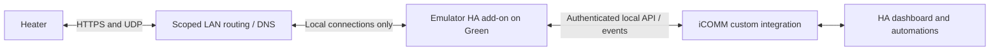

# Fully local Ayla/iCOMM cloud emulator: implementation plan

Status: implementation in progress, November 11, 2026. Target: the tested HPTS-80, controller
firmware 5.4. Device support beyond that profile requires separate validation.
This plan replaces LAN-key provisioning as the main development path.

## Objective and completion criteria

Run the heater's replacement HTTPS and UDP notification services on the Home
Assistant Green. Home Assistant must read fresh telemetry and control target
and mode with the heater's Internet access denied and the development NUC off.
No A. O. Smith account, cloud API call, or mobile app action may be required for
normal operation, bootstrapping after installation, or recovery.

The original mobile app is a cloud client; making it continue working offline
is outside this objective. The heater's physical controls remain the fallback.
Initial scope is target/mode and validated status, not emulating every cloud
account, utility, firmware-update, or ownership service.

## Evidence and unresolved questions

| Area | Verified on this heater | Still to prove |
|---|---|---|
| HTTPS | Accepts our RSA/SHA256 TLS 1.2 DHE endpoint; requests and replies captured | Complete local bootstrap/authentication, reconnect and recovery |
| Commands | Real 129/130°F and four mode commands captured; matching telemetry observed | Command delivery without a cloud-generated poll |
| Telemetry | `superBlockDyn1` layout and target/mode decoded | Reliable fresh reads and required periodic-report configuration offline |
| UDP | Router connection tracking showed bidirectional notification-service traffic | Actual datagram capture, decryption, wire format and notification effect |
| UDP codec | Related agent source and synthetic decoder tests available | Compatibility with this network-module firmware and its current key |
| HA | Prototype config entry/listener/entity load on Green | Emulator-backed operation, availability and recovery |

Milestone 1 passed on November 11: real UDP registration signing and encrypted
packet CRCs were validated, and a Green-hosted relay observed notify → ack →
HTTPS commands GET → telemetry. A first bounded local-server trial received
HTTPS telemetry with Internet access blocked; fresh local bootstrap and control
remain unproven. See `development-capture.md` for implementation/test status.

Past proxy errors changed the HTTP Host authority and may have caused long
retry delays. Preserve the original OEM Host when forwarding to the real cloud;
preserve HTTP framing/encoding and authentication/time headers. A synthetic 401
only refreshed authentication in our test; it did not force an identity snapshot.
Do not repeat that as a bootstrap strategy.

## Runtime architecture

Use an add-on for the protocol daemon and the existing custom integration for
entities. The add-on can retain protocol state and connections while HA Core
restarts. It also isolates the required legacy TLS settings from HA Core's
normal TLS configuration. No MQTT broker or always-on NUC is required.

Proposed listeners, subject to a port-conflict check:

- HTTPS presented on the Green's TCP 443, if free, mapped to the daemon's
  internal TLS port. If 443 is unavailable, use TCP 8444 with an explicit
  heater-scoped router port redirect. Verify availability before choosing.
- UDP 55055 and 55056; investigate 55057 if observed, rather than assume its role.
- An authenticated API/event stream on a separate local management port, with
  access limited to HA. Use a distinct random API token, not a protocol key.

Reserve the Green and heater LAN addresses. Prefer supported local DNS overrides
for the identified vendor names, so persistent operation does not depend on
hand-installed router iptables rules. Use a per-device DNS view if available;
otherwise document whether an override affects any other matching devices. If
DNS alone is insufficient, prove the router supports durable source-scoped
redirects, including after gateway reboot/upgrade, before choosing that design.
Cover cached vendor addresses and endpoint rotation; returning the Green's
address in a bootstrap response is insufficient if the heater cannot reach that
first response.
Verify A/AAAA lookups and any IPv6 path before claiming isolation. No public
port forwarding is needed. The eventual routine network path is heater/router/
Green; the NUC is only a development tool.

## Milestone 1 — obtain a usable bootstrap and UDP transcript

1. Record normal settings and current cloud/app health. Save a verified HA backup
   and a rollback script before another live redirect.
2. Prepare a working byte-preserving HTTPS relay and a bounded UDP relay on the
   Green. The UDP relay records datagrams at the application socket, avoiding
   reliance on captures hidden by router/AP acceleration.
3. Redirect only this heater's relevant traffic for a short, independently
   expiring test. Initially forward both channels unchanged. Do not introduce
   command injection until baseline cloud communications work through it.
4. Capture a fresh session, including DNS, device identity, notification key,
   UDP registration, replies, keepalives/probes and an ordinary app action.
   A coordinated normal heater power cycle may be necessary to obtain that
   bootstrap. No Wi-Fi pairing reset, hotspot mode or moving the NUC is required.
5. Correlate timestamps: app request, UDP message, HTTPS command fetch, command
   reply, acknowledgement, telemetry. Test idle operation as well as heating.
6. Check the source-derived AES-CBC/key-length, registration signature,
   encapsulation, CRC, sequence, timestamp and reply rules against real packets.
   Existing saved ANS keys may be stale; do not assume either matches.

Exit: a reproducible transcript and successful decoding/validation of real
messages in both directions, with the notification-to-fetch relationship tested.
Keep raw transcripts/keys private; create independently generated fixtures for
public tests. Do not publish copied proprietary agent source.

## Milestone 2 — implement the linked HTTPS/UDP state machine

A shared installation/device state store will own identity, generated local
notification secrets, sessions, pending commands and reported telemetry.
Generate fresh per-installation certificates/private keys and protocol secrets;
never ship a shared key or depend on saved cloud credentials.

HTTPS implementation:

- Reproduce the observed identity/registration/authentication exchange, stable
  device IDs, token renewal, Date/unix-time fields and reconnect behavior.
- Advertise the local notification service and supply a locally owned key in
  the exact format accepted by the firmware; confirm actual length/encoding.
- Accept and validate uploads, including `superBlockDyn1`, write acknowledgements
  and other observed properties. Do not reinterpret firmware consent as a
  request to download or install firmware.
- Serve `commands.xml` from a small local queue and reproduce any required
  periodic-parameter configuration from verified traces.
- Support known recovery paths when observed, including registration-token or
  configuration refresh. Do not reply success indiscriminately to unknown paths.
- Preserve correct keepalive, request-body, response-framing and encoding behavior.

UDP implementation:

- Register the device and verify its registration proof using the local secret.
- Issue a session registration ID and implement observed keepalive/probe/reply
  timers, including alternate-port behavior and notification acknowledgements.
- Generate a notification when HA queues a command. Enforce session/sequence
  rules and reject malformed, stale or wrong-session packets.
- Handle duplicate messages, retransmission, source-port changes and device
  restart without requiring an Internet service.

Do not assume the synthetic codec is sufficient. CRC is an integrity check, not
proof of a modern authenticated-encryption design; restrict listeners to the
configured heater/network and accurately document the legacy protocol.

Exit: offline protocol/client simulation passes bootstrap, notification, command
fetch, acknowledgement, telemetry, loss/retry, malformed-message and reconnect
cases. Exercise HTTPS and UDP together, not only isolated encoders.

## Milestone 3 — prove one completely local command

1. Bring up the emulator on the Green and review the exact scoped redirect,
   WAN-denial rules and independent five-minute rollback.
2. Establish a healthy session using only local services, then deny the heater's
   Internet access while preserving its LAN path to the Green and any explicitly
   required local DNS/time service. Identify DNS/NTP dependencies rather than
   silently leaving vendor access available.
3. Queue one small target change within the existing allowed range; send a local
   UDP notification and record the resulting HTTPS command fetch and readback.
4. Restore the recorded baseline target and mode through the local path and
   confirm them in fresh device telemetry.
5. Repeat while the tank is idle. There must be no app action, cloud API request
   or pre-existing cloud-triggered command poll in this proof.

Exit: local notification -> command fetch -> application -> fresh confirmation,
with WAN denial verified by network counters. Initial latency target: confirmed
response within 30 seconds; measure it rather than present it as guaranteed.
If notifications do not cause fetching, investigate that state transition before
claiming local control or building the final dashboard.

## Milestone 4 — finish the Home Assistant integration

- Package an ARM64 add-on for the Green; also support an x86_64 development build.
- Add an emulator backend to the custom integration. Keep the experimental direct
  LAN-key transport separate; migrate/configure the existing preview explicitly.
- Use event-driven telemetry and an authenticated local command API. No cloud
  login appears in the finished setup flow.
- Expose target temperature and the four verified modes. Start with the current
  maximum target limit, no generic raw-register writes, and only tested duration
  behavior for Electric/Vacation.
- A command is pending until fresh telemetry confirms it. An HTTP response or
  write acknowledgement alone is not success. Expire unsent commands; never
  replay an old command after a restart. Resolve concurrent wall/app/HA changes
  explicitly and avoid silently overwriting a newer physical-control change.
- Expose last contact, last telemetry, pending/error state and protocol health.
  Mark the entity unavailable when information is stale rather than optimistic.
- Add a basic HA dashboard card. Keep unverified tank-temperature mappings
  disabled, and add energy/hot-water/fault entities only after correlation.

Exit: HA service calls, errors, availability and display match actual device
telemetry; HA Core can restart without interrupting the add-on's heater session.

## Milestone 5 — recovery and permanent local operation

Run a 24–48-hour WAN-blocked soak, including idle/heating cycles. Verify:

- HA Core restart, add-on restart, full Green reboot and normal heater power cycle.
- Heater startup with Internet already blocked and no cached cloud session.
- Complete household Internet outage, DNS/cache expiry and notification retries.
- Lost/duplicate packets, stale sessions, bad checksums, expired commands and
  interrupted command/readback sequences.
- Physical controls still operate and settings remain sensible if the Green is
  unavailable. HA accurately reports remote control unavailable in that case.
- Backup/restore retains installation identity, keys, certificates and settings;
  certificate renewal does not strand the device.

After those pass, replace temporary rules with reviewed persistent rules and
heater-only WAN isolation. Manual rollback remains documented. Do not silently
re-enable vendor access as an automatic fallback to a failed local emulator.
Completion requires normal operation with the NUC shut down and zero vendor
cloud connectivity, not merely successful emulation while the cloud is reachable.

## Milestone 6 — community release

Keep the current local Git repository as the source of truth. Add the add-on,
integration, synthetic fixtures, CI/build checks, model/firmware support matrix,
installation/rollback instructions and troubleshooting examples. Attribute
protocol research and independently implement the wire behavior. Audit files
and Git history for credentials, keys, household identifiers, raw captures,
app binaries and proprietary disassembly before release.

Mark the first release experimental and limited to the validated profile.
Publish/push only after the owner supplies GitHub details and the implementation
has passed the real-device acceptance tests. A complete protocol emulator need
not reproduce the vendor's account website or mobile app.

## Immediate next task

Build the Green-hosted, short-lived UDP recording/forwarding harness and link it
to the proven HTTPS pass-through. Obtain one clean bootstrap transcript. That
is the next evidence needed; more HTTP path guesses or arbitrary metadata writes
are not prerequisites for this emulator plan.

## References

- Home Assistant add-on networking/configuration:
  https://developers.home-assistant.io/docs/add-ons/configuration/
- Related Ayla notification wire-format definitions (reference only):
  https://github.com/ddkity/Roomba1.4.3/blob/master/component/common/ayla/libayla/include/ayla/notify_proto.h
- Related device-agent HTTPS/notification state machines (reference only):
  https://github.com/ddkity/Roomba1.4.3/tree/master/component/common/ayla/libada
- Prior heater-specific observations, including later corrections:
  https://github.com/ericboehs/aosmith-water-heater/blob/main/ARCHITECTURE.md
